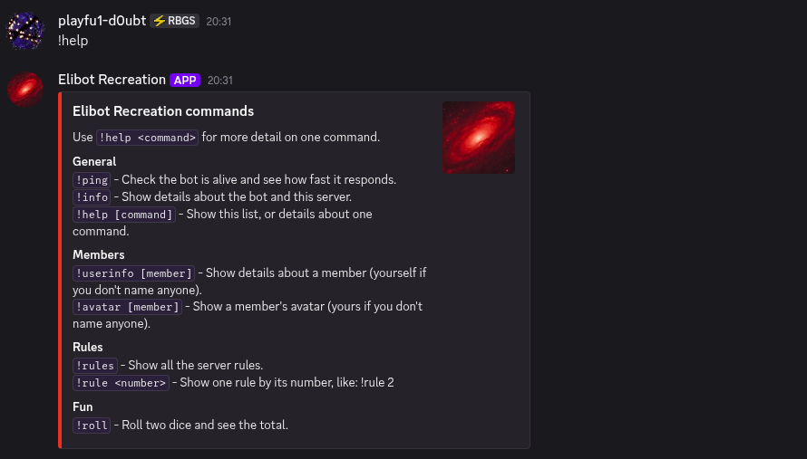
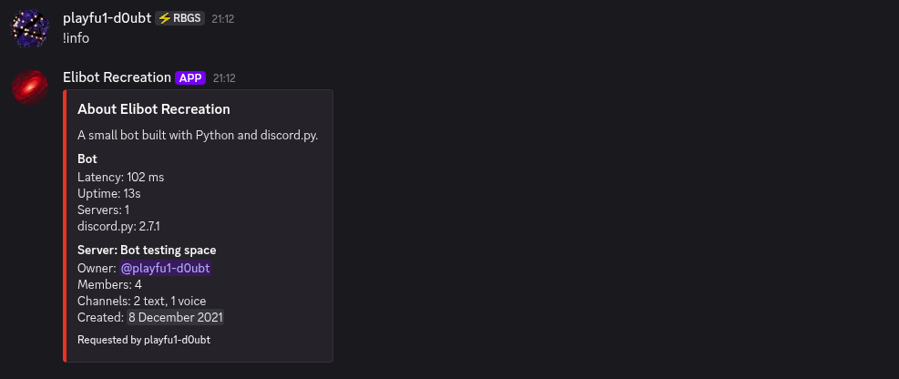
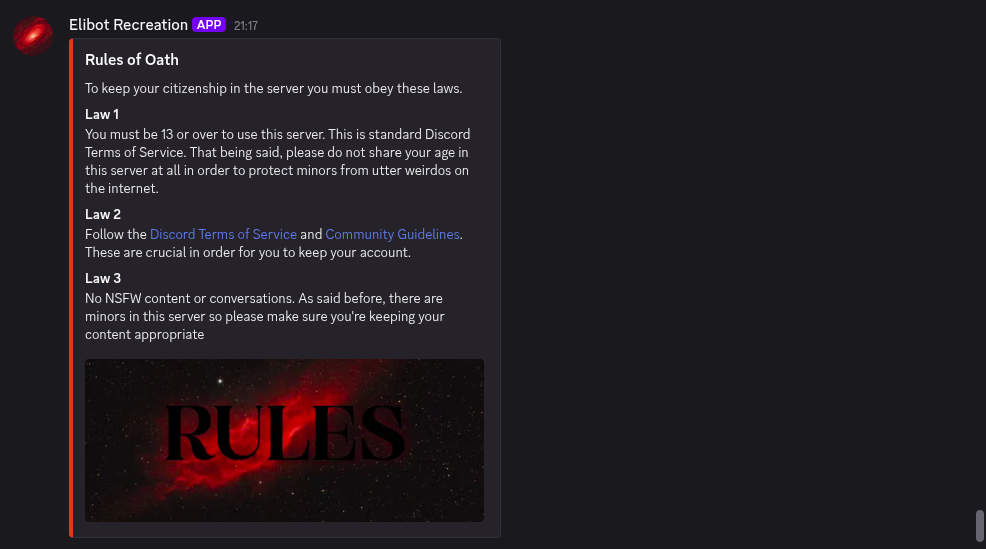
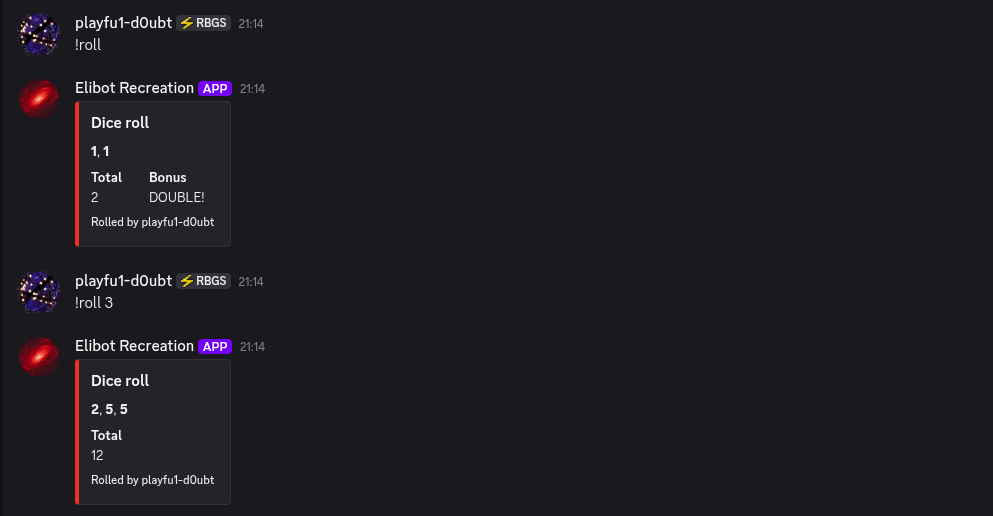

# Discord Bot

A Discord bot written in Python with [discord.py](https://discordpy.readthedocs.io/). It shows information about the server and its members, posts the server rules, rolls dice, and has a help command that replies with a tidy embed.

It's a rebuild of an earlier bot of mine, with more commands, input checking and friendly error messages.

## Commands

All commands start with `!`.

| Command | What it does |
| --- | --- |
| `!help` | Lists every command, grouped by category |
| `!help <command>` | Shows how to use one command, like `!help roll` |
| `!ping` | Replies with `pong` and the bot's response time |
| `!info` | Shows an embed with details about the bot (latency, uptime, version) and the server (owner, members, channels, creation date) |
| `!userinfo [member]` | Shows details about a member: username, top role, when they joined and when their account was made. Leave the member out to see yourself |
| `!avatar [member]` | Shows a member's avatar. Leave the member out to see yours |
| `!rules` | Shows all the server rules in one embed, with a banner picture |
| `!rule <number>` | Shows a single rule, like `!rule 2` |
| `!roll [dice]` | Rolls dice and shows each one with the total. Rolls 2 by default, up to 10, like `!roll 3`. It adds a bonus line when every die matches |

`!info` and `!userinfo` only work inside a server. If a command is used wrongly, the bot replies with a message pointing to `!help` instead of failing silently.

## Setup

You need Python 3 and a Discord account.

### 1. Create the bot on Discord

1. Go to the [Discord Developer Portal](https://discord.com/developers/applications) and click **New Application**.
2. Open the **Bot** tab, click **Reset Token**, and copy the token somewhere safe. It's only shown once.
3. On the same tab, under **Privileged Gateway Intents**, switch on **Message Content Intent**. The bot can't read commands without it.
4. Open **OAuth2 > URL Generator**. Tick the **bot** scope, then tick the permissions **View Channels**, **Send Messages**, **Embed Links** and **Attach Files**.
5. Open the generated link and add the bot to a server you manage. A private test server is a good place to start.

### 2. Run it

```bash
git clone git@github.com:playfu1-d0ubt/discord-bot.git
cd discord-bot
python3 -m venv venv
source venv/bin/activate        # on Windows: venv\Scripts\activate
pip install -r requirements.txt
cp .env.example .env
```

Open `.env` and replace `your-token-here` with your bot's token. Then start the bot:

```bash
python bot.py
```

The terminal prints `Logged in as <bot name>` and the bot appears online. Type `!help` in a channel it can see. Stop it with `Ctrl+C`. The bot only responds while the script is running.

**Keep the token private.** `.env` is listed in `.gitignore` so it isn't uploaded. If the token ever leaks, reset it on the Bot tab and the old one stops working.

## Screenshots






## Customising it

| What to change | Where |
| --- | --- |
| The server rules, their title and the intro line | `rules.py` |
| The banner picture shown with `!rules` | `assets/rules_banner.webp` (if the file is missing, the rules are sent without a picture) |
| The embed colour, the bot description, the most dice `!roll` allows | The settings at the top of `bot.py` |
| Which commands appear under which heading in `!help` | `HELP_CATEGORIES` in `bot.py` |

A new command that isn't listed in `HELP_CATEGORIES` still appears in `!help`, under "Other".

## Project layout

```
discord-bot/
├── bot.py            # the bot and all of its commands
├── rules.py          # the rules text
├── assets/           # the banner picture for !rules
├── screenshots       # screenshots of bot working for README
├── .env.example      # shows what goes in your .env file
└── requirements.txt  # the packages to install
```

## Limitations

- The bot runs on your own computer, so it's only online while `bot.py` is running.
- It uses `!` commands, which need the Message Content intent. Discord's newer slash commands (`/help`) aren't added yet.
- Everything is held in the code and files. There's no database, so nothing is remembered between runs.

## Ideas for later

- Slash commands as well as `!` commands
- Hosting it so it stays online all the time
- More commands, like a poll or a reminder
